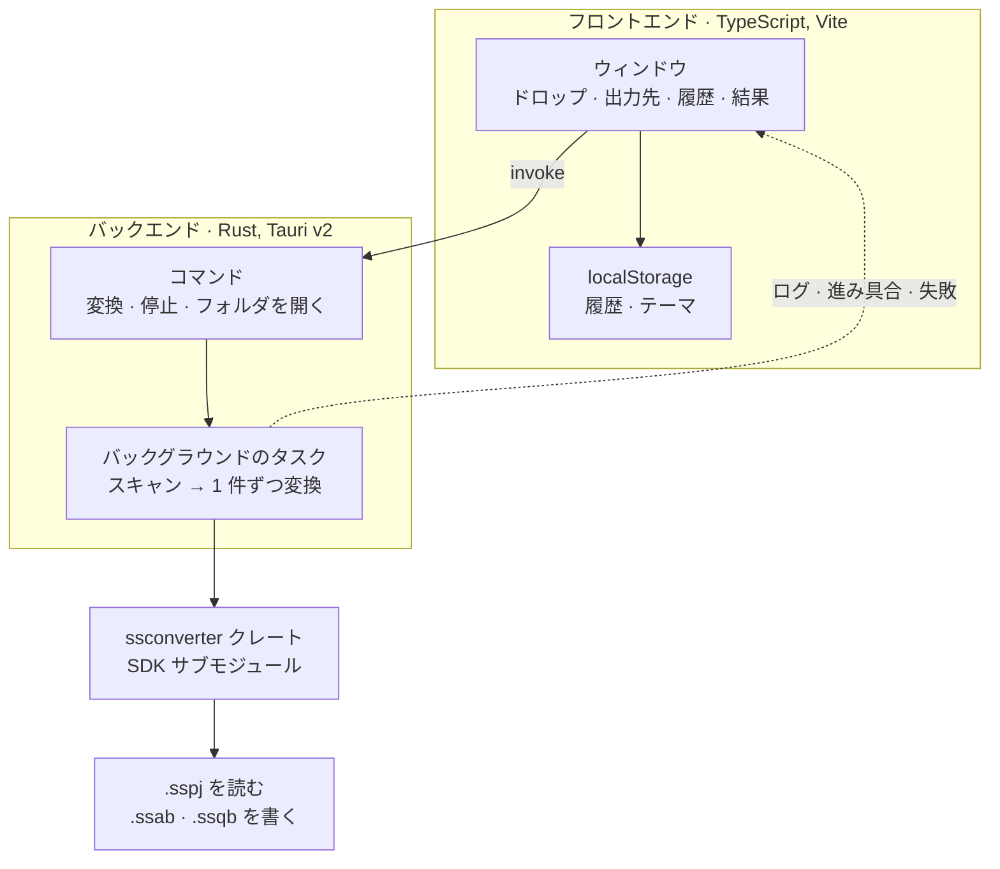

# 🛠️ 開発者向け

このページは、アプリケーション（GUI フロントエンドと、SDK の `ssconverter` クレートを呼ぶ Rust バックエンド）をソースから改変・ビルドしたい開発者向けです。変換そのものの変更は SpriteStudio-SDK で行います。アプリケーションを使うだけの場合は、[インストール](install.md)を参照してください。

## 🛠️ 技術スタック

- **バックエンド / フレームワーク**: [Tauri v2](https://v2.tauri.app/) (Rust)
- **フロントエンド**: [Vite](https://vitejs.dev/)
- **UI 実装**: TypeScript / HTML / Vanilla CSS（重量級のフレームワークは使用していません）
- **コア変換ロジック**: [SpriteStudio-SDK](https://github.com/cri-middleware/SpriteStudio-SDK)
  (`ssconverter` Rust クレート)

## 🧩 アプリの構成



フロントエンドがウィンドウ全体で、履歴とテーマを `localStorage` に持ちます。Tauri の IPC でバックエンドのコマンドを呼び、バックエンドはバックグラウンドのタスクで変換するので、ウィンドウは固まりません。ドロップしたフォルダはまずスキャンします（誤ってホームフォルダを落としても終わるよう、件数と時間に上限があります）。そのあと 1 件ずつ変換し、コンバーターのメッセージ・進み具合・失敗をイベントでウィンドウへ返します。**「Stop / Cancel」** は、スキャンとコンバーターの両方が見るフラグを立てます。

単体の変換で **「📂 Reveal Output」** が開くフォルダは、コンバーターが自分のログで示したもので、アプリは計算しません（一括では選んだフォルダを開きます）。**「📤 Output」** の行に出す既定の出力先は、コンバーターの命名規則をアプリ側で言い直したものです。そのためテストが SDK のフィクスチャを変換して、ログの行と規則の両方を確かめます。どちらかを変えるサブモジュールの更新は、アプリではなくそのテストで落ちます。

## ⚙️ 開発環境の要件

ソースコードからアプリケーションをビルドするには、以下の環境が必要です。

- **Node.js**: `v26` 以上を推奨。パッケージマネージャーとして `pnpm` を使用します。未インストールの場合は、あらかじめ `npm install -g pnpm`（または `corepack enable pnpm`）を実行してください。
- **Rust ツールチェーン**: [rustup](https://rustup.rs/) を経由したインストール。
- ご利用の OS における Tauri v2 の[前提条件 (Prerequisites)](https://v2.tauri.app/start/prerequisites/)
  を満たしていること（Windows なら C++ Build Tools、macOS なら Xcode Command Line Tools、Linux なら必要なライブラリ）。

## 🚀 セットアップと実行手順

### 1. リポジトリとサブモジュールのクローン

変換のコア機能として `SpriteStudio-SDK` をサブモジュールとして使用しています。クローンする際は必ず
`--recursive` フラグを使用してください。

```bash
git clone --recursive https://github.com/cri-middleware/SSConverterGUI.git
cd SSConverterGUI
```

### 2. 依存関係のインストール

```bash
pnpm install
```

### 3. 開発モードでの起動

Rust によるコアロジックのビルドを含め、変更をリアルタイムに検知する開発サーバーを立ち上げて GUI を起動します。

```bash
pnpm run tauri dev
```

### 4. アプリケーションのビルド

アプリをリリースモードでビルドします。実行ファイルは `src-tauri/target/release/` に、プラットフォームごとのバンドルは `src-tauri/target/release/bundle/` に出力されます。

```bash
pnpm run tauri build
```

### 5. リリース用アーカイブのビルド（任意）

`pnpm run tauri build` では、リリースが配るアーカイブはできません。リリース時に実際にアップロードされるもの
—— 同じアーカイブ名・同じ構成で、`LICENSE.md`、`LICENSE.ja.md`、`THIRD_PARTY_NOTICES.md` を同梱したもの —— を手元で再現するには `build-release` を実行してください。`.github/workflows/release.yml` が実行するのは**このスクリプトそのもの**なので、リリースを実行しなくてもパッケージングや署名、クロスコンパイルの問題を検出できます。

```bash
# macOS（ユニバーサル: Apple Silicon + Intel）
scripts/build-release.sh

# 試行錯誤時に短縮する場合（アーカイブの内容はリリース版と異なります）
scripts/build-release.sh sign=no notices=no
```

```powershell
# Windows（x86_64 と arm64 クロスビルド）
./scripts/build-release.ps1

# 片方だけビルドする場合
./scripts/build-release.ps1 arch=x86_64
```

いずれもそのマシンで作れる分だけをビルドし —— プラットフォーム固有のビルド自体は
`scripts/release-macos.sh` と `scripts/release-windows.ps1` が受け持ちます —— 続けてアーカイブを検査し、
`SHA256SUMS` を隣に書き出します。アーカイブは `dist-release/`（git 管理外）に出力されます。

両方のマシンのアーカイブが 1 つのディレクトリに揃ったら、`scripts/build-release.sh build=no` が 3 つをまとめて検査し、マニフェストを書き出します。ワークフローは Release を作る前にこの手順を実行します。これが重要な検査です。何も生成しなかったマトリクスエントリや、古いバージョンの残骸アーカイブは、そうでなければ気づかれないまま Release に添付されてしまうためです。

オプションの一覧は `--help` で確認できます。主なものは次のとおりです。

- **ライセンス表記**: [cargo-about](https://github.com/EmbarkStudios/cargo-about) で生成します
  (`cargo install cargo-about`)。`notices=no` を渡すとこの手順を省略でき、素早く確認できますが、アーカイブの内容はリリース版と異なります。
- **Windows arm64**: Visual Studio インストーラーの **MSVC v143 - VS 2022 C++ ARM64 build tools**
  コンポーネントが必要です。Rust のターゲット追加はスクリプトが行います。生成物はビルドした x86_64 ホスト上では実行できないため、動作確認は Arm 実機で行ってください。`arch=x86_64` を渡せばスキップできます。
- **macOS の署名・公証**: 任意です。ワークフローと同じ環境変数で制御します。`APPLE_SIGNING_IDENTITY`
  を設定すると署名し、さらに `APPLE_API_KEY` / `APPLE_API_ISSUER` と、`APPLE_API_KEY_PATH` または
  `APPLE_API_KEY_BASE64` のいずれかを設定すると公証と staple まで行います。その後スクリプトは完成した
  `.app` を実際に検査し、指定したはずの処理が行われていなければ **エラーで終了** します（証明書の失効や設定漏れがあると、署名は黙って何もしないまま通過してしまうためです）。いずれも設定しなければ未署名のアプリが生成され、その旨が表示されるだけです。`sign=yes` を渡すと環境変数の状態にかかわらず署名・公証・
  staple 済みであることを必須にし（CI が `v*` タグで渡す指定です）、`sign=no` を渡すと環境変数を無視して未署名でビルドします。ローカルでは `APPLE_CERTIFICATE` は設定しないでください。CI ではこの変数で
  `.p12` を渡し、Tauri CLI が一時キーチェーンへ取り込みますが、ローカルでは既存のキーチェーンから証明書が解決されるためです (`security find-identity -v -p codesigning`)。なお Windows の実行ファイルは意図的に署名していないため、Windows 側に `sign=` はありません。

## 📚 ドキュメントのビルド

本サイトは MkDocs と Material テーマの後継である [Zensical](https://zensical.org/) で構築されており、他の SpriteStudio Player リポジトリと同じ構成です。ソースは `docs/en/` と `docs/ja/` にあり、ビルドは 2 つのスクリプトが受け持ちます。

### macOS / Linux (bash)

```bash
scripts/prepare-docs.sh          # 初回のみ。.venv を作成し docs/requirements.txt を導入
scripts/build-docs.sh            # CI と同一。リンク切れで失敗する

.venv/bin/zensical serve                   # 英語を http://127.0.0.1:8000 でライブプレビュー
.venv/bin/zensical serve -f mkdocs.ja.yml  # ... または日本語をプレビュー
```

### Windows (PowerShell)

```powershell
scripts\prepare-docs.ps1
scripts\build-docs.ps1

.\.venv\Scripts\zensical serve                   # 英語をライブプレビュー
.\.venv\Scripts\zensical serve -f mkdocs.ja.yml  # ... または日本語をプレビュー
```

いずれのスクリプトも `key=value` 形式のオプションと `--help` を受け付けます（`build-docs.sh locale=ja`、`prepare-docs.sh force=yes`）。`zensical serve` はリンクを検証せず、一度に 1 ロケールしか配信しないため、ビルドの代わりにはなりません。言語セレクターが働く状態でビルド済みのサイトを見るには、`scripts/build-pages.sh serve=yes`（Windows は `.ps1`）を実行します。`pages.yml` が公開するのと同じツリーをビルドし、`site/` をポート 8000 で配信します。

Zensical は **1 ロケールにつき 1 つの設定ファイル** でビルドするため、ビルドはロケールごとに実行され、
`build-docs` はその順序を保証します。英語を先にビルドするのは、英語ビルドが出力先の `site/` を開始時に消去し、日本語サイトはその内側（`site/ja`）に出力されるためです。英語だけをビルドすると日本語サイトは残りません。

すべてのページは `docs/en/` と `docs/ja/` に 1 つずつ存在します。ページを追加・移動・リネームする際は**両方のロケール**で行い、`mkdocs.yml` と `mkdocs.ja.yml` の **両方** の `nav` にもエントリを追加してください。どちらかが欠けても、strict ビルドは気付きません。
